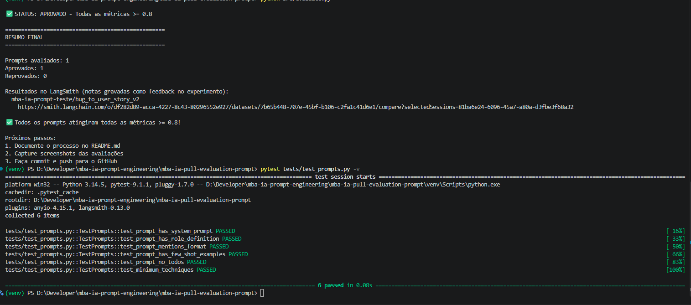
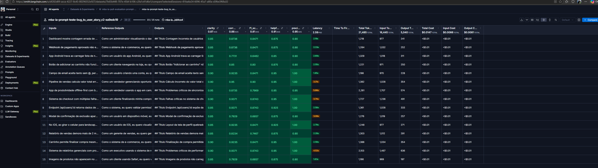

# Pull, Otimização e Avaliação de Prompts com LangChain e LangSmith

Projeto desenvolvido para o desafio de **Prompt Engineering** do MBA em Inteligência Artificial da Full Cycle. O objetivo é recuperar um prompt inicial do **LangSmith Prompt Hub**, refatorá-lo utilizando técnicas avançadas, publicar a nova versão e avaliar sua qualidade em um conjunto fixo de exemplos.

O caso de uso consiste em **converter relatos de bugs em histórias de usuário estruturadas**, preservando as informações relevantes e evitando acrescentar requisitos não fornecidos.

## Objetivo e critérios de aprovação

O desafio exige:

- Realizar **pull** de prompts a partir do LangSmith Prompt Hub.
- Otimizar o prompt original (`v1`) e publicar uma versão aprimorada (`v2`).
- Empregar **Few-shot Learning** e pelo menos uma técnica adicional de Prompt Engineering.
- Avaliar a versão otimizada em um dataset de **15 relatos de bugs** (5 simples, 7 médios e 3 complexos).
- Obter **nota mínima de 0,80 em cada uma** das cinco métricas: Helpfulness, Correctness, F1-Score, Clarity e Precision.
- Disponibilizar código, instruções de execução e evidências no LangSmith.

## Tecnologias

- Python 3.10+
- LangChain e LangChain Core
- LangSmith (Prompt Hub, datasets, experimentos, feedback e tracing)
- OpenAI ou Google Gemini, conforme configuração do ambiente
- YAML para definição dos prompts
- Pytest para validação automatizada

## Estrutura do projeto

```text
mba-ia-pull-evaluation-prompt/
├── .env.example
├── .gitignore
├── README.md
├── requirements.txt
├── datasets/
│   └── bug_to_user_story.jsonl
├── prompts/
│   ├── bug_to_user_story_v1.yml
│   └── bug_to_user_story_v2.yml
├── screenshots/
│   ├── console.png
│   └── lang.png
├── src/
│   ├── pull_prompts.py
│   ├── push_prompts.py
│   ├── evaluate.py
│   ├── metrics.py
│   └── utils.py
└── tests/
    └── test_prompts.py
```

> As pastas `venv/`, `.pytest_cache/` e arquivos `.env` com credenciais não devem ser versionados. As capturas devem ficar na pasta `screenshots/` na raiz do projeto, não dentro de `.pytest_cache/`.

## Técnicas Aplicadas (Fase 2)

A versão `v2` foi estruturada com três técnicas complementares.

### 1. Few-shot Learning

**Motivação:** oferecer exemplos concretos do formato e do nível de detalhamento esperados, reduzindo ambiguidades na conversão de relatos de bugs em histórias de usuário.

**Aplicação:** exemplos de entrada e saída orientam a estrutura da resposta, a identificação do comportamento esperado e a redação de critérios de aceitação. A técnica ajuda a padronizar respostas em casos simples e complexos.

**Exemplo ilustrativo:** um relato como “Ao salvar o cadastro, o sistema mostra erro e perde os dados preenchidos” deve produzir uma história centrada na preservação dos dados e critérios verificáveis para o salvamento, sem inventar regras de negócio.

### 2. Role Prompting

**Motivação:** definir explicitamente o papel do modelo como analista de requisitos, direcionando a linguagem e o foco da resposta.

**Aplicação:** instruções de sistema delimitam a responsabilidade de transformar informações do bug em uma história de usuário clara e útil para o desenvolvimento, sem especular sobre causas técnicas não demonstradas.

### 3. Skeleton of Thought

**Motivação:** induzir uma organização consistente antes da elaboração da resposta final, especialmente em relatos extensos ou com múltiplas informações.

**Aplicação:** a saída segue uma estrutura previsível, contemplando a necessidade do usuário, o comportamento desejado e critérios de aceitação. Isso melhora a legibilidade e facilita a avaliação automática.

### Regras de qualidade e casos-limite

A otimização também busca:

- Preservar o significado do relato original.
- Evitar requisitos, funcionalidades e detalhes técnicos não sustentados pelo bug.
- Usar linguagem objetiva e critérios de aceitação verificáveis.
- Tratar descrições incompletas ou ambíguas sem apresentar suposições como fatos.
- Manter consistência entre exemplos, instruções e formato da saída.

## Comparação entre os prompts v1 e v2

| Aspecto | Prompt original (v1) | Prompt otimizado (v2) |
|---|---|---|
| Orientação | Instruções iniciais menos detalhadas | Papel e objetivo definidos explicitamente |
| Exemplos | Sem a mesma orientação por exemplos | Few-shot Learning para demonstrar o padrão esperado |
| Organização | Maior liberdade de estrutura | Estrutura guiada por Skeleton of Thought |
| Tratamento de ambiguidades | Menos direcionamento | Regras para preservar informações e evitar invenções |
| Consistência | Maior variação potencial | Maior padronização da história e dos critérios |
| Validação | Versão de referência | Avaliação automatizada com cinco métricas |

A alteração central foi substituir instruções genéricas por **contexto, papel, exemplos e regras explícitas**, tornando as respostas mais consistentes e verificáveis. A comparação acima descreve a abordagem de refatoração; os valores numéricos de avaliação apresentados a seguir referem-se à execução final da `v2`.

## Resultados Finais

A avaliação da versão otimizada foi realizada com o dataset de **15 exemplos** disponibilizado no desafio.

| Métrica | Nota final | Meta | Status |
|---|---:|---:|---|
| Helpfulness | 0,91 | ≥ 0,80 | Aprovado |
| Correctness | 0,88 | ≥ 0,80 | Aprovado |
| F1-Score | 0,81 | ≥ 0,80 | Aprovado |
| Clarity | 0,87 | ≥ 0,80 | Aprovado |
| Precision | 0,95 | ≥ 0,80 | Aprovado |
| **Média das métricas** | **0,884** | **≥ 0,80** | **Aprovado** |

**Resultado final: APROVADO.** Todas as métricas superaram o mínimo individual exigido pelo desafio.

Os testes automatizados também foram executados com **6 testes aprovados**.

### Evidências da avaliação

**Resultado da execução no terminal:**



**Experimentos e avaliação no LangSmith:**



**Dataset e experimentos públicos no LangSmith:** [https://smith.langchain.com/public/5b3a776e-e4c9-4ff9-8bca-a26cf5e2acd2/d](mba-ia-pull-evaluation-prompt-eval)

### Como compartilhar o dataset no LangSmith

O link exibido ao final de `src/evaluate.py` pode exigir acesso ao workspace. Para gerar um link público, utilize o nome real do projeto configurado no ambiente:

```python
from langsmith import Client

client = Client()
resultado = client.share_dataset(dataset_name="SEU_LANGSMITH_PROJECT-eval")
print(resultado["url"])
```

Execute o compartilhamento apenas quando estiver pronto para publicar o link; um novo compartilhamento pode alterar a URL.

## Como Executar

### 1. Pré-requisitos

- Python 3.10 ou superior
- Git
- Conta no LangSmith e chave de API
- Acesso a um provedor de LLM suportado pelo projeto (OpenAI ou Gemini)

### 2. Clonar o repositório

```bash
git clone https://github.com/wandrelito/mba-ia-pull-evaluation-prompt.git
cd mba-ia-pull-evaluation-prompt
```

Substitua `SEU_USUARIO` pelo proprietário do fork publicado.

### 3. Criar e ativar o ambiente virtual

No Windows (PowerShell):

```powershell
python -m venv venv
.\venv\Scripts\Activate.ps1
pip install -r requirements.txt
```

No Linux/macOS:

```bash
python3 -m venv venv
source venv/bin/activate
pip install -r requirements.txt
```

### 4. Configurar variáveis de ambiente

Crie o arquivo `.env` a partir do exemplo:

```powershell
Copy-Item .env.example .env
```

No Linux/macOS, utilize `cp .env.example .env`.

Preencha as variáveis previstas no `.env.example`, especialmente as credenciais do LangSmith, a identificação do projeto e a chave do provedor de LLM escolhido. **Não publique o arquivo `.env` nem chaves de API.**

### 5. Recuperar os prompts originais (pull)

```bash
python src/pull_prompts.py
```

O script recupera os prompts do LangSmith Prompt Hub, conforme a implementação do desafio.

### 6. Otimizar o prompt

Revise o arquivo:

```text
prompts/bug_to_user_story_v2.yml
```

A versão `v2` contém as técnicas descritas na seção **Técnicas Aplicadas (Fase 2)**. O dataset de avaliação e os scripts-base de métricas não devem ser modificados.

### 7. Publicar a versão otimizada (push)

```bash
python src/push_prompts.py
```

### 8. Executar a avaliação

```bash
python src/evaluate.py
```

A execução avalia o prompt otimizado, calcula as métricas e registra feedback e traces no LangSmith.

### 9. Executar os testes automatizados

```bash
pytest tests/test_prompts.py -v
```

Na execução documentada, os **6 testes foram aprovados**.

## Critérios de entrega

- [x] Prompt `v2` otimizado com técnicas avançadas de Prompt Engineering.
- [x] Fluxo de pull e push de prompts.
- [x] Avaliação de 15 exemplos com as cinco métricas exigidas.
- [x] Notas finais iguais ou superiores a 0,80 em todas as métricas.
- [x] Seis testes automatizados aprovados.
- [x] Documentação das técnicas, comparação e instruções de execução.
- [x] Inserir e verificar link público do dataset/experimentos LangSmith.
- [ ] Confirmar que o compartilhamento evidencia tracing de pelo menos três exemplos.
- [ ] Confirmar que as imagens estão versionadas em `screenshots/`.

## Referência

Repositório-base do desafio: [devfullcycle/mba-ia-pull-evaluation-prompt](https://github.com/devfullcycle/mba-ia-pull-evaluation-prompt).
